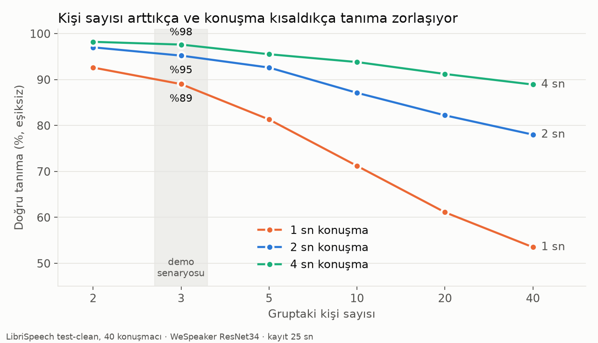

# Pulsar: a speech-to-speech coach for group conversation practice

Pulsar listens to a small group (3–4 people) practising English on **one mixed audio stream** and joins in as a
coach. It works out *who* is speaking and *how*, decides on its own whether a turn was meant for it, and answers
only those turns, by name, through a speech-to-speech model. It also tracks each person's share of talking time
and asks quiet people a question.

Each part was measured on real human speech (AMI meeting recordings, LibriSpeech, and my own voice recordings).
No synthetic TTS audio was used anywhere, not even for smoke tests. The numbers below come from those measurements.
The known weaknesses are listed at the end.

> Portfolio / learning project (November 2026). Runs in **replay mode** (a WAV file fed in real time); live
> microphone input and an onboarding phase are the next step.

## How it works

```
 mixed audio (16 kHz)                                            all events → JSONL log (no transcript text)
   │ 32 ms blocks
   ▼
 Silero VAD ──► turn (speech segment, cut after 500 ms of silence)
   │
   ├─► speaker split + ID ── WeSpeaker ResNet34 (ONNX) embeddings, cosine vs each person's enrollment centroid,
   │                         τ = 0.45 and margin 0.05 or "unknown"; sliding windows split turns where the speaker changes
   ├─► ASR ───────────────── Parakeet TDT 0.6B v3 (MLX), words with timestamps            (parallel with the above)
   └─► prosody ───────────── speech rate, pauses, mean length of run, fillers, F0 → z-scores vs the person's own baseline
   │
   ▼
 addressing rules ── 0) addressed to another participant → no   1) "Pulsar" within 1 edit (ASR often hears "Pussar")
   │                 2) follow-up window after Pulsar replied   3) question + Pulsar addressed in the last 30 s
   │ yes
   ▼
 COACH NOTE ── "Speaker: Alper. Reply by name… [tone line if struggling] Recent group talk: …"
   ▼
 Gemini 3.8 Live (manual activity: activity_start → turn audio → note → activity_end) ──► 24 kHz reply ──► speaker

 turn manager: IDLE → WAITING → PULSAR_SPEAKING → follow-up window · barge-in on name · 10 s silence timeout
 proactive:    ≥ 3 s silence + someone below 15% talk share (after 2 min) → text-only question to that person
```

Turn-taking stays local; the speech-to-speech model never decides who is speaking or whether to answer. That way the
model knows who to address and how before it starts generating, and only turns addressed to Pulsar leave the machine.

## Results

| What | Data | Result |
|---|---|---|
| Speaker ID, 3 enrolled people, clean turns | AMI (real meetings), 25 s enrollment | **96%** correct (no threshold); with τ/margin: 89% correct, 9% "who asked that?", **1.9% wrong name** |
| Speaker ID vs group size, 2 s turns | LibriSpeech, 40 speakers | 95% (3 people) → 78% (40 people): matching should stay inside the group |
| Same, with **real VAD turns** end to end | 4 AMI meetings, 809 turns | 65% correct, 27% unknown, **8.4% wrong name**; single-speaker turns ≥ 2 s are 98% correct (top-1) |
| Splitting turns at speaker changes | same | talk-time assigned to the right person 57.5% → **65.7%**; wrong names in long turns 11% → 3% |
| Talk-share counter | AMI | 2–6 points off the ground truth; picked the right quiet person for a proactive question |
| VAD vs reference | 2 AMI meetings | recall 78–84%, precision 99% |
| ASR | AMI + own recordings | ~150–200 ms per turn unpaced, 2.0 GB peak memory on an 8 GB M2 |
| Addressing rules | own recordings (15 lines) | 12/12 single lines, 10/10 in a scripted conversation (rules were tuned on these lines, so this is optimistic) |
| Gemini answers by name | live | 4/4 in the scenario; earlier 9/9; occasional silence (1 of 16 calls) |
| Latency, end of speech → first reply audio | live, short turns | **2.0–2.8 s** (target was 1.5 s); text-only proactive prompts ~0.6 s |
| "Speak ~25% slower" in the note | live, 5 + 5 calls | only **~7%** slower; the model does not reliably follow pace instructions |

Details, tables and charts (Turkish): [`reports/README.md`](reports/README.md) and the per-experiment files in `reports/`.



## Known issues and what I would do next

Each of these was observed in a measurement:

- **Overlapping speech** causes most wrong names: in 45 of 48 wrong names inside mixed turns, two people were
  talking at the same time. Fix: target-speaker extraction (VoiceFilter / SpeakerBeam / WeSep) or target-speaker VAD
  (TS-VAD), conditioned on the enrolled voiceprints.
- **ASR is ~5× slower when paced in real time** (~1 s instead of ~150 ms), probably macOS power management on an idle
  process. GPU warm-up and thread QoS did not help. Next: streaming ASR during the turn (Parakeet has a streaming mode).
- **Pace instructions barely work** on Gemini Live. Next: time-stretch Pulsar's audio locally (WSOLA), or use an S2S
  model with a speed parameter.
- **Short sub-turns created by splitting (1–2 s)** get the wrong name 19% of the time; τ/margin should be re-tuned on
  real VAD turns.
- **Unenrolled strangers** are accepted as an enrolled person ~10% of the time (3 enrolled). Next: AS-norm or
  per-speaker thresholds.
- Gemini closes idle sessions after ~2 min; Pulsar reconnects before sending (~0.6 s extra on that reply).
- **Live microphone + onboarding phase** (Pulsar greets each person, records 20–30 s for the voiceprint, the prosody
  baseline and a CEFR/interests profile) is not built yet; replay uses RTTM labels for enrollment instead.
- Longer term: per-learner memory across sessions (RAG over session summaries, retrieved once per session), and
  voiceprint storage scoped to a group, never a global "whose voice is this" search.

## Run it

Requirements: Apple Silicon Mac (MLX), [uv](https://docs.astral.sh/uv/), a Gemini API key.

```bash
uv sync
echo "GEMINI_API_KEY=..." > .env
# speaker embedding model (ONNX, ~26 MB)
mkdir -p models && curl -L -o models/wespeaker_en_voxceleb_resnet34_LM.onnx \
  https://github.com/k2-fsa/sherpa-onnx/releases/download/speaker-recongition-models/wespeaker_en_voxceleb_resnet34_LM.onnx
```

Data (not in the repo): AMI Mix-Headset WAVs + RTTM reference files under `data/ami/audio/` and `data/ami/rttm/`
(e.g. ES2004a, IS1009a, TS3003a, EN2002a), LibriSpeech test-clean under `data/`. Parakeet downloads on first use (~4.7 GB).

```bash
# replay an AMI meeting: VAD → speaker split/ID → ASR → prosody → talk counter
uv run python -m pulsar --meeting ES2004a --max-s 120
# same, measured against the RTTM reference (fast, no pacing)
uv run python -m pulsar --meeting ES2004a --speed 0 --no-asr && uv run python scripts/eval_replay.py ES2004a
# with live Gemini replies (needs real-time pacing); --play to hear Pulsar
uv run python -m pulsar --wav my_scenario.wav --rttm my_scenario.rttm --gemini --play
```

## Repository

```
src/pulsar/   audio_in (replay) · vad · speaker · segment (speaker-change split) · asr · prosody · addressing
              coach (COACH NOTE) · s2s (Gemini Live) · player · events (JSONL) · app (pipeline + turn manager)
scripts/      experiments and evaluations (speaker ID on LibriSpeech/AMI, replay eval, ASR, addressing, tone, Gemini)
reports/      results per experiment (Turkish), figures
docs/         status, architecture, decisions K1–K22, research notes (Turkish)
```

## Privacy

Voiceprints are biometric data. They stay in memory and are never written to disk. Raw audio and transcripts are
not stored by the pipeline: the event log holds only events and numbers. Only turns addressed to Pulsar are sent to
the cloud model. Real users would need explicit consent and a paid API tier, because the free tier may use inputs
for product improvement.
