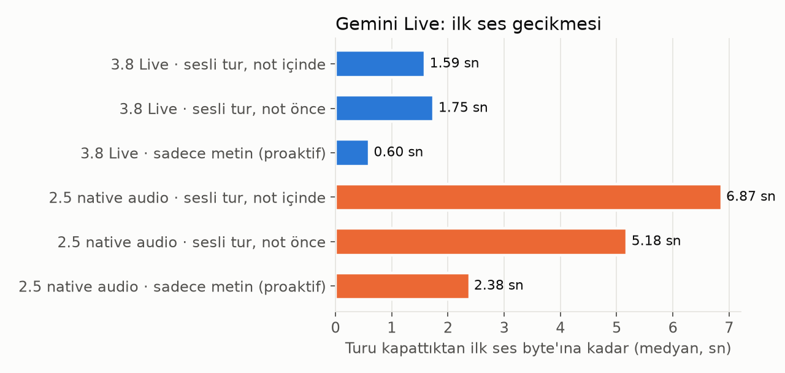
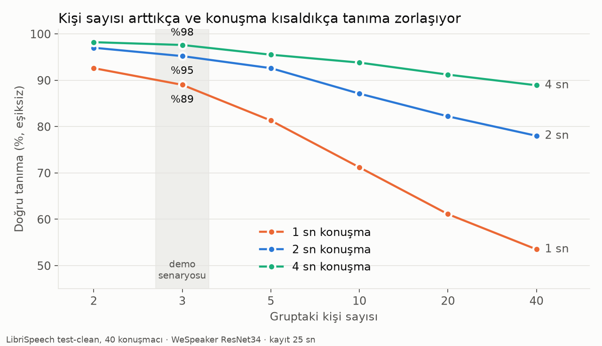
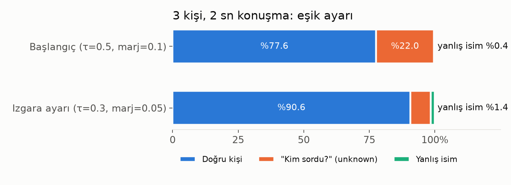
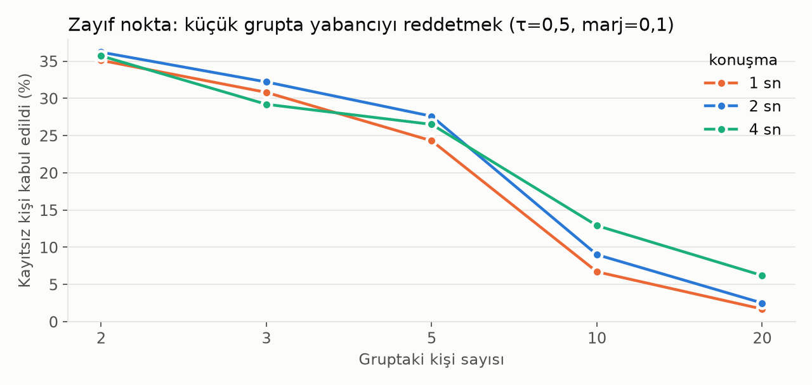

# Bulgular

Pulsar'ın her parçasının ölçüm sonuçları. Ham sayılar her deneyin `.md`/`.json` dosyasında. Grafikler
`scripts/make_figures.py` ile üretiliyor (`reports/figures/`).

| # | Deney | Tarih | Dosyalar |
|---|---|---|---|
| 1 | Gemini Live risk testi | 2026-11-06 | [`gemini_turn_test.md`](gemini_turn_test.md), `.jsonl` |
| 2 | Ses parmak izi: LibriSpeech (40 kişi) | 2026-11-06 | [`speaker_id_librispeech.md`](speaker_id_librispeech.md), `.json` |

---

## 1. Gemini Live: model kime ve ne kadar hızlı cevap veriyor?

**Soru:** Gemini'nin otomatik tur tespitini kapatıp turu kendimiz yönettiğimizde ve kimin konuştuğunu bir
COACH NOTE ile söylediğimizde, model notu okuyup doğru kişiye cevap veriyor mu? Ne kadar hızlı?

**Kurgu:**
- Test sesi gerçek bir insan kaydı (LibriSpeech, 3,27 sn).
- "Ayşe" ismi sesin içinde geçmiyor, **sadece notta** geçiyor. Cevapta "Ayşe" geçiyorsa model notu okumuş demektir.
- Model başına ve tür başına 3 deneme. Her deneme ayrı bir oturumda.

| Model | Not nasıl gönderildi | Cevap geldi | Notu kullandı | İlk ses (medyan) |
|---|---|---|---|---|
| **3.8 Live** | **Turun içinde (A)** | 3/3 | **3/3** | **1,59 sn** |
| 3.8 Live | Turdan önce (B) | 3/3 | 3/3 | 1,75 sn |
| 3.8 Live | Ses yok, sadece metin (proaktif) | 3/3 | 3/3 | **0,60 sn** |
| 2.5 native audio | Turun içinde (A) | 3/3 | 3/3 | 6,87 sn |
| 2.5 native audio | Turdan önce (B) | 3/3 | **0/3** | 5,18 sn |
| 2.5 native audio | Sadece metin | 3/3 | 3/3 | 2,38 sn |

Örnek cevap (3.8). Ses romandan bir cümle okuyor, isim sadece notta var:
> *"That is a funny way to describe hunger, **Ayşe**. Does your belly ever talk to you like that?"*

**Ne öğrendik?**
1. **3.8 Live her denemede cevap verdi (9/9).** Kapatılamayan "proactive audio" özelliği yüzünden modelin
   sessiz kalmasından korkuyorduk; olmadı. Örnek küçük olduğu için zaman aşımı yine de duruyor.
2. **Not turun içinde gönderilmeli.** 2.5 native audio, turdan önce gönderilen notu üç denemede de tamamen yok
   saydı. Turun içindeki not iki modelde de çalıştı. → Karar K17.
3. **Gecikme:** Sesli turda ~1,6 sn, sadece metinde ~0,6 sn. Aradaki ~1 sn modelin sesi işleme süresi. Bizim lokal
   işlemimiz (~0,6 sn) eklenince kişinin susmasından Pulsar'ın konuşmasına ~2,2 sn çıkıyor. Hedef 1,5 sn'ydi.

---

## 2. Ses parmak izi: kimin konuştuğunu ne kadar doğru buluyoruz?

**Soru:** Gruptaki kişi sayısı arttıkça ve konuşma kısaldıkça tanıma doğruluğu nasıl değişiyor? Sistem
emin olmadığında "Kim sordu?" diyebiliyor mu?

**Kurgu:**
- **Veri:** LibriSpeech test-clean, 40 gerçek kişi.
- **Kayıt:** Her kişiden 25 sn ses alınıyor. Ses 2 sn'lik parçalara bölünüp her parçanın ses imzası çıkarılıyor;
  ortalamaları kişinin profili oluyor.
- **Test:** Aynı kişilerin kayıtta kullanılmayan cümlelerinden 1, 2 ve 4 sn'lik parçalar.
- **Gruplar:** 2'den 40'a kadar farklı büyüklükte rastgele gruplar.
- **Model:** WeSpeaker ResNet34 (ONNX). 2 sn ses için ~60 ms.

**Kişi sayısı arttıkça ne oluyor?** (eşik yok, en benzer kişi seçiliyor)

| Gruptaki kişi | 1 sn konuşma | 2 sn konuşma | 4 sn konuşma |
|---|---|---|---|
| 2 | %92,6 | %97,0 | %98,2 |
| **3 (demo)** | **%89,0** | **%95,2** | **%97,6** |
| 5 | %81,3 | %92,6 | %95,5 |
| 10 | %71,2 | %87,1 | %93,8 |
| 20 | %61,1 | %82,2 | %91,2 |
| 40 | %53,5 | %78,0 | %88,9 |

**Eşik kullanınca ne oluyor?** Eşik, sistemin emin olmadığı durumda tahmin yürütmek yerine "Kim sordu?"
(`unknown`) demesini sağlıyor. Kural: en iyi skor ≥ τ **ve** en iyi skor ile ikinci arasındaki fark ≥ marj.

| 3 kişi, 2 sn | Doğru | "Kim sordu?" | Yanlış isim |
|---|---|---|---|
| Başlangıç ayarı (τ=0,5, marj=0,1) | %77,6 | %22,0 | %0,4 |
| **Izgara aramasıyla bulunan ayar** (τ=0,3, marj=0,05) | **%90,6** | **%7,9** | **%1,4** |

**Zayıf nokta: kayıtlı olmayan birini reddetmek.**

| Gruptaki kişi | 2 | 3 | 5 | 10 | 20 |
|---|---|---|---|---|---|
| Kayıtsız kişi gruptan birine atandı (2 sn, τ=0,5, marj=0,1) | %36,2 | %32,2 | %27,6 | %9,0 | %2,5 |

**Ne öğrendik?**
1. **Kişi sayısı arttıkça doğruluk düşüyor.** 2 sn'de 3 kişiyle %95, 40 kişiyle %78. Aramayı grup içinde
   tutmanın (MIMARI §11.2) ölçülmüş gerekçesi bu.
2. **1 sn çok kısa.** Turun tamamı kullanılmalı; 2 sn ve üzeri güvenilir.
3. **Yanlış isim oranı her ayarda %2'nin altında kaldı.** Hedef buydu. Eşiğin bedeli "Kim sordu?" oranında
   görülüyor; ızgara ayarı bu oranı %22'den %8'e indirdi.
4. **Küçük grupta yabancıyı reddedemiyor.** Aday sayısı azken yabancının en çok benzediği aday da kolayca eşiği
   geçiyor. Demo için ikincil bir sorun (herkes kayıt oluyor), ürün için çözülmesi gerekiyor
   (bkz. `docs/ARASTIRMA_ISTEGI_kayitsiz_kisi.md`). Araştırma raporu skor normalizasyonunu "demo için gereksiz"
   demişti; ölçüm bu konuda fazla iyimser olduğunu gösterdi.

**Sınır:** LibriSpeech temiz, tek mikrofonlu sesli kitap kaydı. Bu sonuçlar bir **üst sınır**. Gerçek toplantı
sesiyle (AMI) yapılacak test sıradaki adım.
